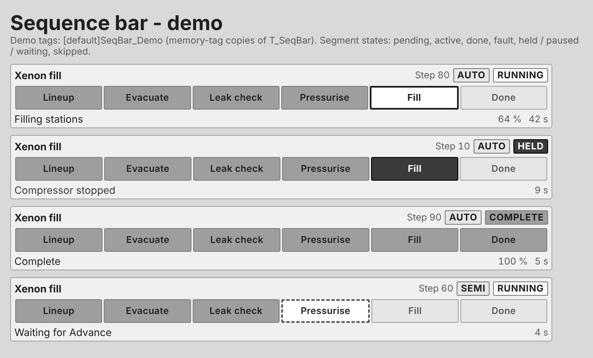

# FB_Phase: ISA-88 phase DFBs and sequence bar (Control Expert Classic V16.2, Ignition 8.1)

These IEC 61131-3 Structured Text DFBs run a sequence on a `T_Phase` (PCLib). They use the ISA-88 Part 1 state model, commands, modes and ownership. A companion DDT, `T_SeqBar`, drives the HMI sequence bar: the step bar on the station faceplate (Vessel, Vac, Prefill, Fill, Sample, Done), now generic for any phase.

All files are generated by `gen_phase.py`. Edit the generator and re-run it; don't edit the outputs by hand.

> **Not yet imported into Control Expert or Ignition.** The ST compiles in MatIEC (an open-source IEC 61131-3 compiler) and passes a 41-check process simulation (`tests/`). Check the items under [First import](#first-import-check-these) on the first project.

## Files

| File | Use |
|---|---|
| `export/PCLib_DFB_Phase_CE_V16.2.xdb` | **Import this.** It holds the DDTs `T_Phase`, `T_SeqBar`, `T_FillStn` and `T_XeFill`, and the DFBs `FB_PhaseCore`, `FB_Phase` and `FB_PhXeFill`. |
| `export/T_SeqBar.xdd` | `T_SeqBar` on its own, for projects that only need the DDT |
| `dfb/*.st` | IEC 61131-3 source for review, version control and a manual build |
| `examples/XeFill_Unit.st` | Example unit program: one xenon fill sequence for six stations |
| `Sequence_Template.md` | Design sheet for a new phase, plus the two xenon examples filled in |
| `ignition/PCLib_SeqBar_UDT.json` | Ignition UDT `_types_/PCLib/T_SeqBar` (OPC tags) |
| `ignition/PCLib_SeqBar_Demo_Tags.json` | Memory-tag copy of the UDT and four demo instances |
| `ignition/EFC_SequenceBar.zip` | Perspective project: `Templates/Sequence/SequenceBar` and `_Demo` |
| `ignition/previews/SequenceBar.png` | The `_Demo` view rendered from `EFC_SequenceBar.zip` with the demo tags |
| `ignition/previews/render_view.py` | Renders the shipped view.json to HTML: evaluates its bindings and uses the real EFC_Styles classes |
| `tests/run_tests.sh` | Compiles everything with MatIEC and runs the simulation |
| `gen_phase.py` | The generator: the source of truth |

## Import (Control Expert)

1. Import `PCLib_DFB_AI_CE_V16.2.xdb` first (from `gen_dfb.py`). The phase DFBs reuse its `T_Alarm`, `FB_AlmCore` and `FB_Alarm`.
   - Alternatively, run `python gen_phase.py --alarm-xdb <path>/PCLib_DFB_AI_CE_V16.2.xdb`. That copies those three types into the phase export, so one file is enough.
2. Go to Project Browser > **Derived FB Types** > right-click > **Import...** and select `PCLib_DFB_Phase_CE_V16.2.xdb`. If `T_Phase` already exists (from `PCLib_CE_V16.2.xdd`), choose **Keep**. The two are identical.
3. Run **Build > Analyze Project**.

If the `.xdb` import fails, build the DFBs by hand from `dfb/*.st` in this order: `FB_PhaseCore`, `FB_Phase`, `FB_PhXeFill`.
- Enter the `VAR_*` blocks as the DFB's inputs, in/outs, outputs and private variables.
- Paste the code after the last `END_VAR` into an ST section named `Main`.

## How it fits together

```
FB_Ph<Name>   (one DFB per phase, made from the FB_Phase template)
  A  labels     sequence-bar title and segment labels, first scan
  B  clear      requests to the core and equipment requests -> FALSE every scan
  C  SEQUENCE   OPEN AREA: CASE Ph.Sts_State / CASE Ph.Sts_Step, written per phase
  D  fbCore     FB_PhaseCore: states, commands, modes, ownership, watchdog, alarms, bar
  E  outputs    equipment requests -> output pins
        |  IN_OUT                     |  IN_OUT
     Ph : T_Phase                  Bar : T_SeqBar  ---> Ignition UDT ---> SequenceBar view
```

`FB_PhaseCore` is the same in every phase, so a fix there reaches all phases on the next import. The sequence runs first and the core second. A command therefore acts on the scan it arrives, and the new state's logic runs from the next scan.

```
(* Variables: PH_XeFill : T_Phase; BAR_XeFill : T_SeqBar; XE : T_XeFill; fbXeFill : FB_PhXeFill; *)
fbXeFill(PermOK := PermOK, IntlkOK := IntlkOK, IntlkAbort := FALSE, EStop := EStopAct,
         Ph := PH_XeFill, Bar := BAR_XeFill, U := XE);
```

Call each phase once per scan in MAST. It measures its own elapsed time, so it doesn't depend on the task period. Like `FB_AI`, it uses no located variables, no global variables and no system bits.

## Making a new phase

1. Fill in `Sequence_Template.md`: equipment pins, parameters, reports, bar segments, the step table and the Hold / Restart / Stop / Abort behaviour.
2. Copy the template. Either:
   - add a new dict to `gen_phase.py` next to `FILL` and `FEED`, then add it to `DFBS` (recommended: it keeps the core call and the request block identical to the other phases), or
   - in Control Expert, copy `FB_Phase` and rename it `FB_Ph<Name>`.
3. Add the equipment pins. Clear each request in section B, set it in the steps that need it, and copy it to its output pin in section E.
4. Write section A (bar labels) and section C (the open area), following the rules in the open-area comment:
   - Number steps 10, 20, 30 …; the core starts every state's logic at step 10.
   - Request transitions with `iNext` + `xTrans`, and finish a state with `xDone`. Never write `Ph.Sts_State` or `Ph.Sts_Step`.
   - Do one-time work on `fbCore.StepEntry`, not in a transition branch.
   - Gate timers with `NOT fbCore.StepEntry`, so a timer reused in several steps restarts in each one.
   - Report failures with `iFail` + `sFail`. The core puts the phase in Holding.
5. Delete the 5 s placeholder step from the template.

## State model (ISA-88 Part 1)

| # | State | Entered by | Sequence logic | Leaves when |
|---|---|---|---|---|
| 0 | Idle | Reset | none | Start |
| 1 | Running | Start, Resume, end of Restarting | running steps from 10 (or the resume step) | `xDone` → Complete |
| 2 | Complete | running logic done | none | Reset |
| 3 | Pausing | Pause | running steps continue | next transition → Paused |
| 4 | Paused | transition while Pausing | **none**; requests drop to section B. A `4:` branch keeps equipment running if needed | Resume → Running at the next step |
| 5 | Holding | Hold, failure, interlock, Manual mode | hold logic from step 10 | `xDone` → Held |
| 6 | Held | holding done | none | Restart, Stop, Abort |
| 7 | Restarting | Restart | restart logic from step 10 | `xDone` → Running at `RunStep` |
| 8 | Stopping | Stop | stop logic from step 10 | `xDone` → Stopped |
| 9 | Stopped | stopping done | none | Reset |
| 10 | Aborting | Abort, E-stop, interlock when `IntlkAbort` | abort logic from step 10 | `xDone` → Aborted |
| 11 | Aborted | aborting done | none | Reset |

- **Start** clears the failure, the reports (`Rpt_Real`, `Rpt_DInt`), `Val_RunTime` and the skipped segments.
- **Restart** clears the failure. If the cause is still there, the sequence reports it again and the phase holds again.
- Holding, Stopping and Aborting save the running step, so **Restart resumes the step that was interrupted**.

## Commands

| Cmd | Prog_Cmd | `Sts_CmdMask` bit (value) | Valid in |
|---|---|---|---|
| Start | 1 | 1 (2) | Idle, with `PermOK`, `IntlkOK`, no E-stop, not Manual |
| Stop | 2 | 2 (4) | Running, Pausing, Paused, Holding, Held, Restarting |
| Hold | 3 | 3 (8) | Running, Pausing, Paused, Restarting |
| Restart | 4 | 4 (16) | Held, with `PermOK`, `IntlkOK`, no E-stop, not Manual |
| Abort | 5 | 5 (32) | as Stop, plus Stopping |
| Reset | 6 | 6 (64) | Complete, Stopped, Aborted |
| Pause | 7 | 7 (128) | Running |
| Resume | 8 | 8 (256) | Pausing, Paused |

- `Cmd_` and `Prog_` commands are one-shot; the core clears them after each scan.
- A command that is not valid sets `Sts_CmdRejected`. The HMI greys out buttons with `Sts_CmdMask`.
- Protective conditions take priority over commands:
  - **E-stop** aborts from any active state.
  - **Interlock lost** (`IntlkOK` FALSE) while the procedure runs → Holding, or Aborting if `IntlkAbort`.
  - **Manual mode** while running → Holding.

## Modes and ownership

- **Automatic**: transitions are taken at once.
- **Semi-automatic**: at a transition the phase moves to the next step and **waits there** for `Cmd_Advance` before running it.
  - `Sts_WaitAdvance` is TRUE while it waits.
  - Nothing runs while waiting, and requests drop to section B.
  - Switching back to Automatic releases the wait.
- **Manual**: the phase can't start, and a running phase holds. Use Manual for operating the control modules by hand.
- **Ownership** (`Sts_Owner`): `Prog_Acquire` gives the phase to a recipe (batch server or unit logic). That forces Automatic and makes the phase obey `Prog_Cmd`.
  - The operator can still Hold, Stop and Abort; other operator commands are rejected.
  - `Cmd_TakeOwn` or `Prog_Release` returns the phase to the operator.
- **Batch handshake**: the sequence sets `Sts_ReqCode`. `Prog_ReqAck` clears it.

Pause and Semi-automatic both stop at a step boundary, so the next step doesn't start until the operator says so. Pause takes effect only at the next transition, so pausing during Fill lets every station finish and pauses before shutdown. Use Hold to stop at once.

## Failures, watchdog and alarms

- **Failure**: `iFail` + `sFail` → `Sts_FailCode`, `Val_FailText`, `Alm_Fail`, and the phase goes to Holding. The text is shown on the bar.
- **Step watchdog**: `Cfg_StepTimeout` (T#0S = off).
  - A step can set its own limit with `tStepMax`, or turn the watchdog off with `xWdogOff` for open-ended waits.
  - When the step time is exceeded, `Alm_StepTimeout` comes on. This is an alarm only; the phase does not hold.
  - The watchdog doesn't count while Paused, Held, Idle or waiting for Advance.
- Both alarms go through `FB_Alarm` (ISA-18.2 state model, shelving, acknowledge).

## Sequence bar (`T_SeqBar`)

| Member | Written by | Meaning |
|---|---|---|
| `Cfg_Title`, `Cfg_NumSeg`, `Cfg_SegText[1..10]` | phase DFB (section A), unit logic | title, number of segments, labels |
| `Sts_Seg[1..10]` | core | 0 Pending, 1 Active, 2 Done, 3 Fault, 4 Held / paused / waiting, 5 Skipped |
| `Sts_Skip[1..10]` | sequence | segment skipped this run (cleared at Start) |
| `Sts_ActSeg` | core | active segment (`iSeg` of the running step, kept while held) |
| `Sts_PhState`, `Sts_Mode`, `Sts_Owner`, `Sts_Step`, `Sts_WaitAdv`, `Sts_Fail` | core | copies from `T_Phase`, so the bar needs one tag path |
| `Val_Msg` | core | step message (`sMsg`), failure text, or the state name |
| `Val_StepTime`, `Val_StepPct` | core | time in step, progress within the segment (`iPct`) |

Each step sets `iSeg`, the segment it belongs to, so several steps can share one segment. The core marks segments before the active one Done (or Skipped), and later ones Pending. The active segment is Active, Held (paused, held, stopped or waiting) or Fault (failure or aborted).



## Examples

### FB_PhXeFill: one sequence fills any number of stations

One phase, one `T_Phase` and one sequence bar cover the whole fill: the large source cylinder, the diaphragm compressor, the fill header and up to six stations.
- **Selecting stations**: a station takes part when its target weight `Prm_Real[n]` is above 0. Enter 0 to leave it out.
- **Per-station states**: the common steps run all selected stations together, but each station has its own state (`T_XeFill.Stn[n].Sts_State`):
  - 0 not selected, 1 waiting, 2 recovering heel, 3 evacuating, 4 evacuated, 5 ready
  - 6 fast fill, 7 slow fill, 8 settling, 9 filled, 10 fault
- **Valves close per station**: a station's valves open and close by that station's own progress. Its inlet (the direction valve from the header) closes as soon as that station reaches its weight, while the others keep filling.
- **Station faults**: a station that fails is dropped, with its valves closed and its fault code in `Sts_FailCode`, and the rest carry on. The faults are:
  - 101 leak check
  - 102 over pressure
  - 103 overfill
  - 104 under weight after the maximum top-ups
  - 105 station interlock (`Inp_IntlkOK`)
- **Phase faults** hold the whole sequence:
  - 200 invalid parameters
  - 201 source cylinder at minimum heel
  - 202 compressor stopped
  - 300 no station selected
  - 301 no station left to fill

| Step | Segment | What it does | Next when |
|---|---|---|---|
| 10 | Lineup | select stations, check cylinders, scales, recipe, source heel and compressor | all ready 3 s |
| 20 | Evacuate | per station: heel to the **recovery header** (never vented), then evacuate; each station's valves close when it is done | every station evacuated |
| 30 | Leak check | all evacuated stations held together for `Prm_DInt[2]` s; a leaking station is dropped | time (fail 301 if none left) |
| 40 | Pressurise | 1 s tare pulse to every ready scale | stable 2 s |
| 50 | Pressurise | open the source cylinder | suction ≥ `Cfg_SuctMin` 2 s |
| 60 | Pressurise | start the compressor unloaded on recycle | running 5 s |
| 70 | Pressurise | load until the header reaches setpoint | header ≥ setpoint |
| 80 | Fill | compressor load / unload on the header. Each station runs fast fill, pulsed slow fill, then settle and check, with a top-up if under weight. Its inlet closes at its target. No step watchdog. | every station filled or faulted |
| 90 | Done | close the source, cool the compressor down unloaded, stop it, write the reports | compressor stopped |

| Parameter | Meaning |
|---|---|
| `Prm_Real[1..6]` | target net weight per station (kg); 0 = not filled |
| `Prm_Real[7]` / `[8]` | tolerance + / − (kg) |
| `Prm_Real[9]` / `[10]` | fast → slow change-over / preact (kg before target) |
| `Prm_Real[11]` / `[12]` | heel recovered to (bar g) / evacuation target (mbar abs) |
| `Prm_Real[13]` / `[14]` | leak check maximum rise (mbar) / maximum cylinder pressure (bar g) |
| `Prm_Real[15]` / `[16]` | header setpoint (bar g) / header band (bar) |
| `Prm_DInt[1..6]` | max top-ups, leak check time (s), settle time (s), slow pulse on (ms), slow pulse off (ms), compressor cool-down (s) |
| `T_XeFill.Cfg_HdrMax`, `Cfg_SuctMin`, `Cfg_SrcHeel` | equipment limits: header unload pressure, minimum suction, source minimum heel |
| `Rpt_Real[1..6]` | final net weight per station |
| `Rpt_Real[7..10]` | total filled, source weight at start / end, run time |
| `Rpt_DInt[1]` / `[2]` | stations filled / faulted |

- **Paused, or waiting for Advance in Semi-automatic**: every station is isolated, and the compressor keeps running unloaded.
- **Holding, Stopping and Aborting**: close every station and the source, and stop the compressor.
- **Restarting**: if the compressor had been started, it opens the source and starts the compressor unloaded, then resumes. Stations keep their own states, so each one continues where it stopped, and settling stations settle again.

The station states and results are in `T_XeFill`, ready for per-station tiles on the HMI. The sequence bar shows only the overall sequence.

### XeFill_Unit: the unit program

- Maps the instruments into `XE : T_XeFill`, calls `fbXeFill` and maps the `Out_` requests to the control modules' `Prog_` inputs.
- The operator (or a batch server) enters the station targets and starts the sequence.
- Valve-to-valve interlocks (vacuum and inlet, recovery and inlet) belong in the control modules.

## Ignition

1. Designer > Tag Browser > Import Tags, at the provider root:
   - `PCLib_SeqBar_UDT.json`
   - optionally `PCLib_SeqBar_Demo_Tags.json` (memory tags; needs no PLC)
2. Create one `T_SeqBar` instance per phase. Set `Prefix` to the PLC variable, for example `BAR_XeFill`. Keep `OPCServer` (`BMENUA0100`) and `NodePrefix` (`ns=2;s=`) unless your connection differs. Give the `T_SeqBar` variables the **HMI** attribute in Control Expert.
3. Gateway > Config > Projects > Import `EFC_SequenceBar.zip`. Its parent is `EFC_Styles`. Then either:
   - add it to your project chain, or
   - copy `Templates/Sequence` and the `Seq/Step/*` style classes.
4. Embed `Templates/Sequence/SequenceBar` (640 × 76 at 1080p) with `tagPath` set to the `T_SeqBar` instance.

## Tests

`tests/run_tests.sh` builds MatIEC, compiles the DDTs, the DFBs and the unit program, and runs `tests/sim.c`. It takes about two minutes on first run.

`sim.c` is a scan-by-scan simulation (100 ms) of the fill sequence with six stations. Each station models cylinder pressure from mass, heel recovery, vacuum, a leak, and the scale with tare and valve in-flight; the source, compressor and header are shared. Its 41 checks cover:

- four of six stations filled to different targets: they finish one by one, each inlet closes at its own weight while the others keep filling, and the unselected stations are untouched
- one station failing its leak check (dropped; the others complete), and every station leaking (fail 301, Fault segment)
- a station interlock trip mid-fill (that station dropped, the sequence continues)
- operator Hold and Restart mid-fill
- Pause during fill
- Semi-automatic: eight Advances, stations closed and the compressor unloaded while waiting
- no station selected, E-stop / Abort / Reset, recipe ownership
- the template's placeholder step

MatIEC converts DINT ↔ TIME in seconds, while Control Expert uses milliseconds, so the script patches a copy of MatIEC's runtime to milliseconds.

## First import: check these

- **Import**: the `.xdb` imports, and **Analyze Project** passes in Control Expert V16.2. This includes nested DFB instances (`fbCore` inside each phase) and STRING inputs on `FB_PhaseCore`.
- **TIME conversions**: `DINT_TO_TIME` / `TIME_TO_DINT` work in ms (as `FB_AI` assumes). The fill example uses `Prm_DInt[4]` / `[5]` in ms, and the other times in s.
- **OPC UA**: the arrays (`Cfg_SegText`, `Sts_Seg`) come through the BMENUA0100 as array tags. If they don't, split them into element tags (`Sts_Seg[1]` …) and change the view's `custom.seg` / `custom.txt` bindings.
- **Warm restart**: a phase keeps its state. If the process must not resume after a warm restart, hold the phases from the unit logic on `%S1`.
- **Expressions**: the view indexes arrays as `{view.custom.seg}[n]`. Confirm this on the 8.1 gateway.
