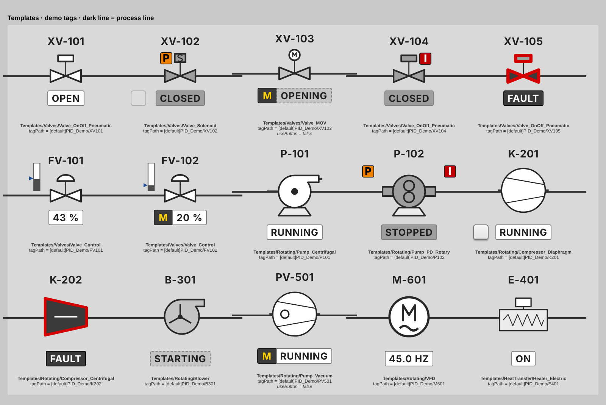

# EFC Ignition Library

Every EFC Ignition Perspective design (**Ignition 8.1**, ready for 8.3) in one repo: the projects, the generators that build them, tags, symbols and design docs. [`docs/inventory.md`](docs/inventory.md) lists every design and its status.

- **EFC_Styles:** the ISA-101 style class library (166 classes, light-gray scheme, vh-scaled from 1080p to 4K).
- **PID_Symbols:** templates for actively controlled devices (valves, pumps, compressors, motors and more). Each template is one symbol, embedded as a Drawing whose fills follow the device state.
- **EFC_PID_Library:** EFC_Styles and PID_Symbols merged into one project with no parent.
- **EFC_ProcessValues:** process-value cards `PV_StatusStrip` and `PV_RangeBar` with ISA-18.2 alarm letters.
- **EFC_IOFaceplates:** Modicon x80 I/O card faceplates with a rack overview (imported export).
- **EFC_StationFaceplates:** DDT_Station scale/fill faceplates (sidebar, fill, tile) with demo tags (imported export).
- **Projects added from existing exports** (PID_Loops is still to come) go in with `tools/import_project_zip.py`. See the inventory.

Current version: see [`VERSION.json`](VERSION.json). What changed: see [`CHANGELOG.md`](CHANGELOG.md).



## Repository layout

```
build.py                 one command to regenerate, check and package everything
VERSION.json             library version + release date (also stamped into resource.json)
generator/               SOURCE OF TRUTH: Python that writes the projects
  build_styles.py          EFC_Styles classes + palette
  build_pid.py             PID_Symbols templates (one per symbol)
  build_pv.py, common.py   EFC_ProcessValues templates + PV demo tags
  pid_common.py            shared layout, binding and SVG-export helpers
  active.py                geometry + state colors for the 16 active symbols
  v2/                      geometry for the 198 static symbols
  check_81.py              static Ignition 8.1 import check
  preview.py, preview_pid.py, make_project_zip.py
projects/                GENERATED, committed so diffs are readable; gateway folder layout
  EFC_Styles/              style classes + advanced stylesheet + Styles/_Catalog view
  PID_Symbols/             templates (parent: EFC_Styles)
  EFC_PID_Library/         both merged into one project with no parent
  EFC_ProcessValues/       PV templates (parent: EFC_Styles)
  <imported>/              projects added from existing exports (see projects/IMPORTED.md)
tools/import_project_zip.py  add an existing project export to projects/
tags/                    GENERATED: PID UDTs + demo instances, PV demo UDT + instances (Tag Browser import JSON)
symbols/                 GENERATED: 214 plain SVGs (static set + symbols/Active)
docs/                    inventory, design notes, briefs, standards, ISA-101 audit, references, style indexes, previews
```

`build/` and `dist/` are build output and are ignored by git.

## Working on the library

Requires Python 3.9 or later, with no packages needed. Previews also need `pip install playwright` and a Chromium.

```bash
# 1. edit generator/*.py
python3 build.py --preview      # 2. regenerate projects/, tags/, symbols/, docs/ and render the preview
git diff --stat                 # 3. review: every template/style change is a JSON diff under projects/
git commit -am "..."            # 4. commit generator AND generated files together
```

- **Don't hand-edit `projects/`.** The next build overwrites it. Change the generator instead.
- **Preview first:** look at `docs/previews/templates.png` before committing a visual change. This is the agreed workflow rule.
- **Releases:**
  1. Bump `VERSION.json` and add a `CHANGELOG.md` entry.
  2. Run `python3 build.py --dist`.
  3. Tag the commit (`git tag v5.2`) and attach the `dist/*.zip` files to the release.
- **CI** (`.github/workflows/check.yml`): rebuilds on every push and fails if the committed `projects/` doesn't match the generator, or if the 8.1 import check fails.

## Getting it onto a gateway

**Option A: import zips (simplest).** Run `python3 build.py --dist`. It writes one `<Project>_PROJECT.zip` per project plus `EFC_Ignition_Library_v<ver>.zip`, a single download bundle. Then in the Gateway web page go to Config → Projects → Import:
- `dist/EFC_PID_Library_PROJECT.zip`: everything in one project. Use this on its own, or as the parent of your HMI project.
- **Or** `dist/EFC_Styles_PROJECT.zip` first, then `dist/PID_Symbols_PROJECT.zip` (the inheritance chain). Don't mix this with Option A's single file in the same chain.

**Option B: copy the folders.** Each folder under `projects/` uses the same layout as the gateway's `data/projects/<Name>/`. Copy the folders you want into `<ignition>/data/projects/`, then have the gateway pick them up: run `system.project.requestScan()` from the Script Console, or restart the gateway. This also works for a gateway-side git clone, by symlinking or copying into `data/projects`.

**Tags:** in the Tag Browser, import `tags/*_UDT.json` into Data Types. Import `tags/PV_Demo_Tags.json` at the `[default]` provider root to try `Templates/ProcessValues/_Demo`. Optionally import `tags/PID_Demo_Instances.json` to try `Templates/_Demo`. Real discrete valves use the plant `DDT_Valve` UDT. See [`docs/library-reference.md`](docs/library-reference.md) for the member mapping, import order and template behavior.

## Adding an existing project
```bash
python3 tools/import_project_zip.py EFC_IOFaceplates.zip EFC_StationFaceplates.zip PID_Loops_PROJECT.zip
python3 build.py && git add -A && git commit -m "Import faceplates and loops"
```
Imported projects have no generator here, so edit them in the Designer, export, and re-import. They are still zipped by `--dist` and checked by `check_81.py`.

## Documentation
- [`docs/inventory.md`](docs/inventory.md): every design, version, status and location.
- [`docs/library-reference.md`](docs/library-reference.md): templates, UDT mapping, status logic, colors, 8.1 compatibility.
- [`docs/design-notes.md`](docs/design-notes.md): every design decision (notes 1–42) and the open items.
- [`docs/isa101-audit.md`](docs/isa101-audit.md): the ISA-101 / ISA-18.2 audit and documented deviations.
- [`docs/style-library.md`](docs/style-library.md) / [`docs/style-class-index.md`](docs/style-class-index.md): how to use EFC_Styles; every class (generated).
- [`docs/pv-display.md`](docs/pv-display.md) / [`docs/pv-style-index.md`](docs/pv-style-index.md): process-value templates.
- [`docs/pid-loop-templates.md`](docs/pid-loop-templates.md): PID loop cards and popup.
- [`docs/screen-layout-standard.md`](docs/screen-layout-standard.md): 16:9 screen layout and graphics conventions.
- [`docs/station-faceplates.md`](docs/station-faceplates.md): station faceplates, member mapping, dock setup.
- [`docs/design-briefs.md`](docs/design-briefs.md): I/O card and station faceplates, compressor screen, Haskel pump.
